# ADBD Práctica 3: Modelo Relacional - Viveros

**Asignatura:** Administración y diseño de bases de datos
**Institución:** Universidad de La Laguna
**Autores:** Diego García Hernández y Marcos Barbuzano Socorro

## Descripción

Este repositorio contiene la resolución de la práctica "Modelo relacional. Viveros". El objetivo principal ha sido realizar el paso de un modelo entidad-relación a un modelo relacional y aplicar sentencias en PostgreSQL para la creación y manejo de la base de datos.

## Estructura del Repositorio

Para cumplir con los requisitos de entrega, el repositorio se organiza de la siguiente manera:

* **`viveros.sql`**: Script SQL único preparado para PostgreSQL que crea la base de datos, define las tablas con sus respectivas restricciones, inserta los datos de ejemplo y ejecuta ejemplos representativos de borrado y actualización.
* **Modelos:** Imágenes del diseño entidad-relación y del modelo relacional.

## Características de la Base de Datos implementada

El script `viveros.sql` incluye las siguientes implementaciones obligatorias:

* **Creación de la base de datos:** Se genera la base de datos `viveros`.
* **Tablas y restricciones:** Se han creado todas las tablas con los tipos de datos adecuados, especificando valores nulos, restricciones tipo `CHECK` (por ejemplo, validación de formatos de DNI y correo, rangos de coordenadas) y comportamiento de actualización y eliminación en cascada (`ON DELETE CASCADE` / `ON DELETE RESTRICT`).
* **Atributos derivados:** El atributo derivado "Precio" del pedido se ha implementado de forma calculada utilizando una vista (`v_pedido`).
* **Datos de prueba:** Se han insertado al menos 5 filas por tabla cubriendo todos los escenarios posibles (ej. zonas sin productos, stock a 0, clientes con o sin bonificaciones, etc.).
* **Ejemplos de `DELETE` / `UPDATE`:** El script incluye bloques transaccionales comprobando los borrados en cascada, borrados rechazados por `RESTRICT` y actualizaciones de claves.

## Instrucciones de Ejecución

Se recomienda la ejecución del script desde la terminal utilizando la herramienta `psql`:

```bash
psql -h localhost -U postgres -f viveros.sql
```

**Nota para usuarios de pgAdmin:**
Si se utiliza el *Query Tool* de pgAdmin, los comandos como `\c` y `CREATE DATABASE` no funcionan en dicha herramienta. En ese caso, se debe crear manualmente la base de datos `viveros`, conectarse a ella y ejecutar el script a partir de la "Sección 1" (omitiendo las líneas que empiezan por `\`).

---

## Modelos de Datos

### Modelo Entidad-Relación
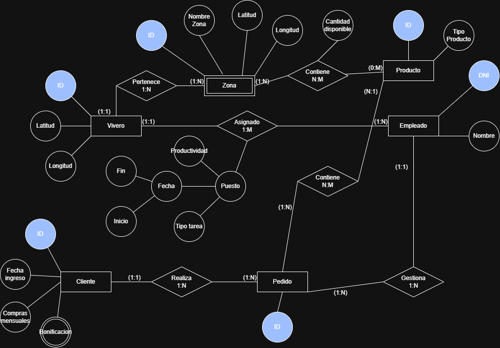

### Modelo Relacional
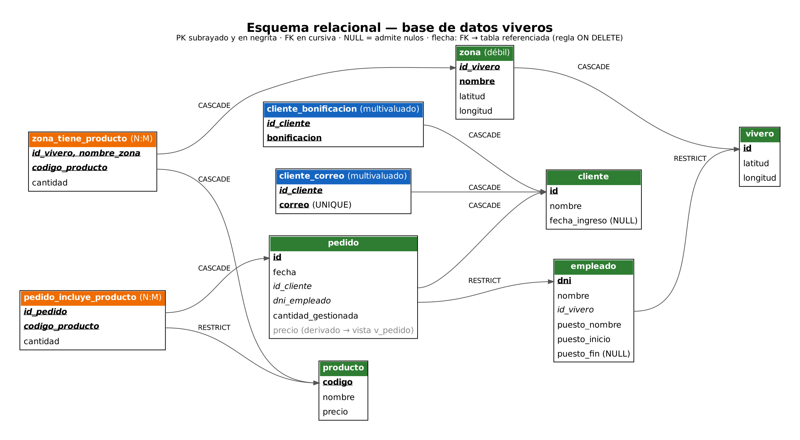

---

## Resultados de Consultas (Comprobación)

A continuación, se muestran las capturas con la salida de los `SELECT` de cada una de las tablas generadas tras la ejecución del script:

### Tabla: Vivero
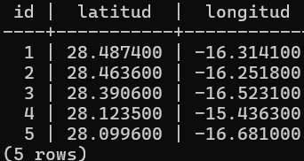

### Tabla: Zona
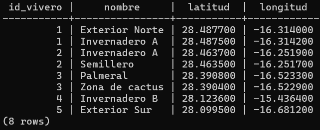

### Tabla: Empleado
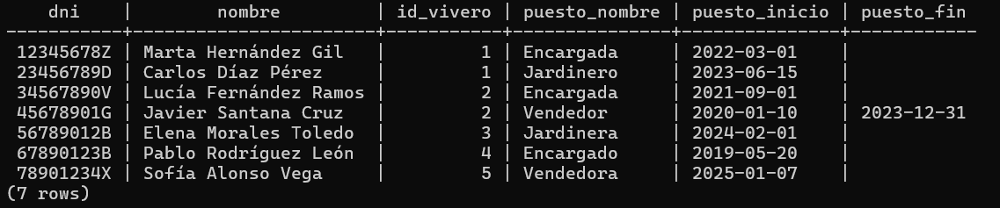

### Tabla: Producto
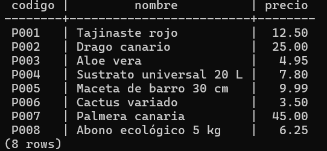

### Tabla: Zona Tiene Producto
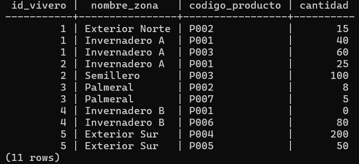

### Tabla: Cliente
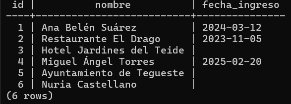

### Tabla: Cliente Correo
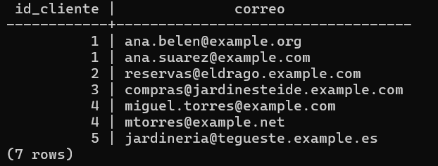

### Tabla: Cliente Bonificación
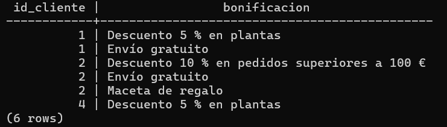

### Tabla: Pedido
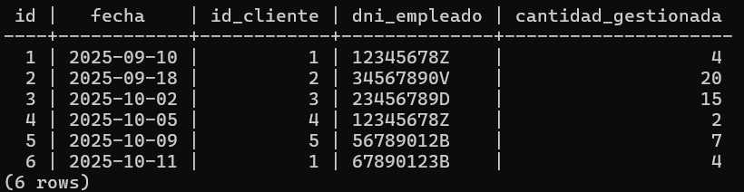

### Tabla: Pedido Incluye Producto
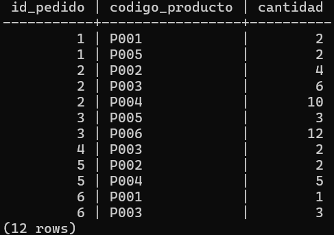

### Vista: Pedido (con atributo derivado calculado)
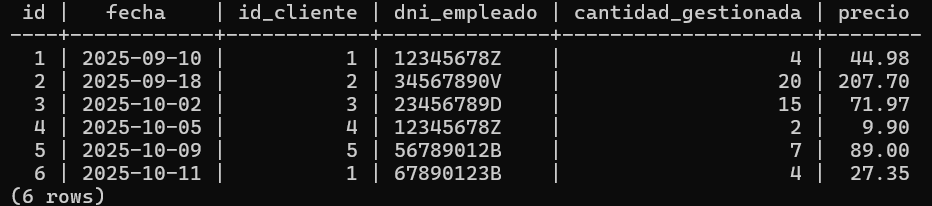
